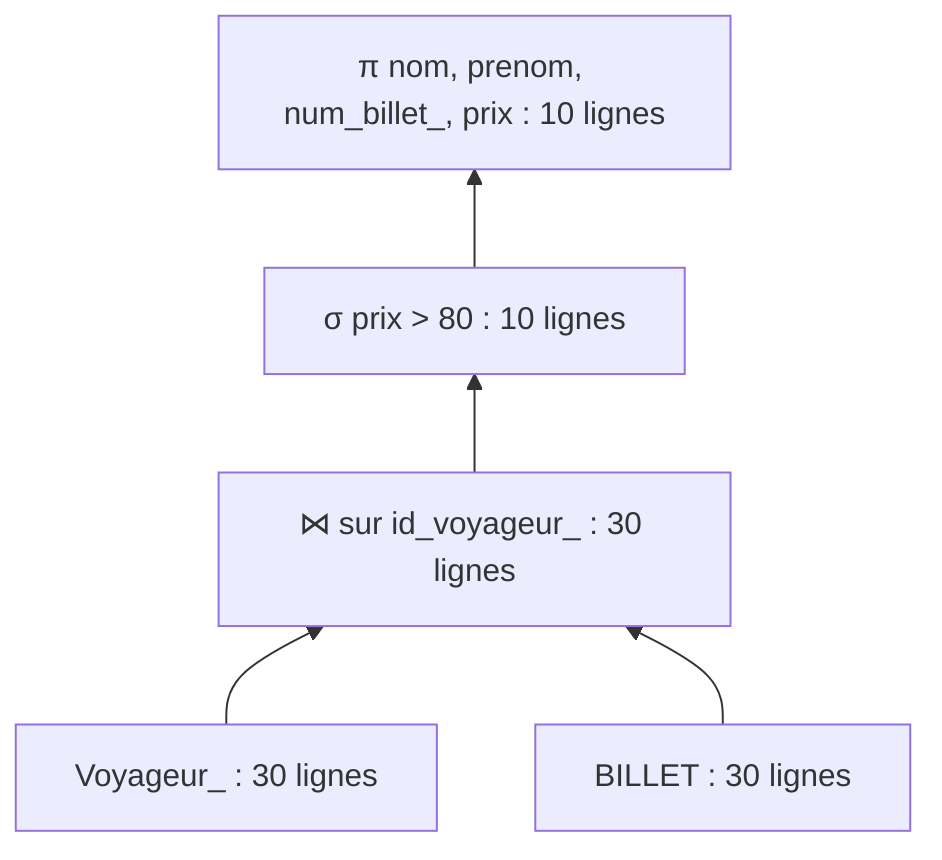
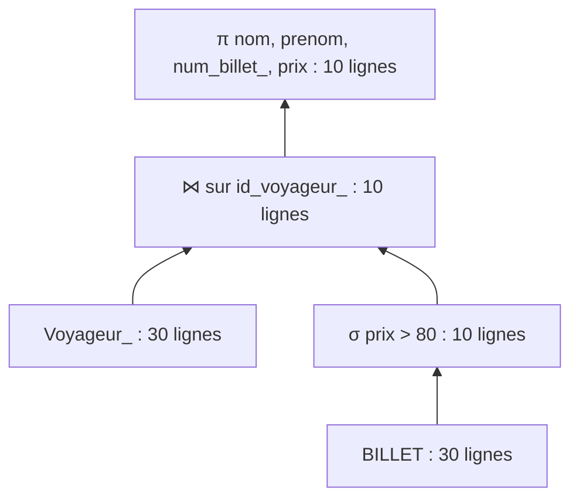

# ProjetDB_Kamokwe_Zankpe

**MINI-PROJET 1 – BASE DE DONNÉES**  
**Étude du Groupe SNCF avec la méthode MERISE**

## Partie 1 — Analyse et conception

### 1. Présentation et périmètre du projet

Dans le cadre de notre mini-projet de bases de données, nous avons choisi d'étudier le Groupe SNCF, une entreprise française spécialisée dans le transport ferroviaire et la mobilité.

Notre objectif est de concevoir une base de données pour représenter plusieurs activités liées au transport de voyageurs : les réservations, les billets, les paiements, les trains, les trajets, les gares et le personnel. Nous avons aussi pris en compte les places, les correspondances et les incidents.

Ce travail nous permet de mettre en pratique la méthode MERISE, de l'analyse des besoins à la création et à l'interrogation d'une base MySQL. Il s'agit d'un projet pédagogique, et non d'une reproduction du système informatique réel de la SNCF.

Les données étudiées concernent notamment :

- les voyageurs et leurs informations personnelles ;
- les billets et les réservations ;
- les paiements et les tarifs ;
- les trains et leurs caractéristiques ;
- les trajets, horaires et correspondances ;
- les gares ;
- les places et les classes de voyage ;
- les employés et leurs fonctions ;
- les retards et les incidents liés aux trajets.

### 2. Sources utilisées

Le projet s'appuie sur des informations publiques relatives aux activités de la SNCF, notamment les informations concernant les voyages, billets, horaires, itinéraires, gares, trains et services aux voyageurs. Les principales références sont les sites officiels de SNCF et de SNCF Voyageurs :

- https://www.sncf.com/
- https://www.sncf-voyageurs.com/

### 3. Règles de gestion des données

- Un voyageur peut effectuer plusieurs réservations.
- Une réservation est effectuée par un seul voyageur.
- Une réservation concerne un billet.
- Un billet correspond à un trajet précis.
- Un billet possède une date d'achat.
- Un billet possède un prix et une classe de voyage.
- Un billet peut être associé à une place lorsque la réservation de place est disponible.
- Un billet peut avoir différents statuts, notamment réservé, payé ou annulé.
- Un paiement est associé à un billet.
- Un paiement possède une date et un montant.
- Un train possède un identifiant unique.
- Un train appartient à un type de train, par exemple TGV, TER, Intercités ou Transilien.
- Un train possède une capacité correspondant au nombre de places disponibles.
- Un train peut effectuer plusieurs trajets à des dates différentes.
- Un trajet est effectué par un train.
- Un trajet possède une gare de départ et une gare d'arrivée.
- Une gare peut être la gare de départ de plusieurs trajets.
- Une gare peut être la gare d'arrivée de plusieurs trajets.
- Un trajet possède une date de départ et une date d'arrivée.
- Un trajet possède une heure de départ et une heure d'arrivée.
- Un trajet peut comporter une ou plusieurs correspondances.
- Une correspondance relie deux étapes d'un déplacement du voyageur.
- Un trajet peut subir un retard.
- Un retard possède une durée et peut être associé à un motif.
- Un trajet peut être concerné par un incident.
- Un incident possède une description et peut être associé à une date.
- Un employé appartient au personnel de la SNCF.
- Un employé possède une fonction, par exemple conducteur, contrôleur ou agent de gare.
- Un employé peut être affecté à un ou plusieurs trajets selon son activité.
- Une fonction peut être exercée par plusieurs employés.
- Une place appartient à un train et peut être identifiée par un numéro.
- Un train peut proposer plusieurs classes de voyage, notamment première classe et seconde classe.

### 4. Dictionnaire de données brutes

Le dictionnaire ci-dessous regroupe les données utiles à l'analyse. Il ne constitue pas encore une modélisation en tables et ne définit pas de clés primaires ou étrangères.

| Signification de la donnée | Type | Taille |
|---|---|---|
| Identifiant du voyageur | Entier | 10 chiffres |
| Nom du voyageur | Texte | 50 caractères |
| Prénom du voyageur | Texte | 50 caractères |
| Date de naissance du voyageur | Date | 10 caractères |
| Adresse du voyageur | Texte | 150 caractères |
| Adresse e-mail du voyageur | Texte | 100 caractères |
| Numéro de téléphone du voyageur | Texte | 20 caractères |
| Identifiant du billet | Entier | 10 chiffres |
| Date d'achat du billet | Date | 10 caractères |
| Prix du billet | Décimal | 8 chiffres |
| Classe de voyage | Texte | 20 caractères |
| Statut du billet | Texte | 20 caractères |
| Numéro de place | Texte | 10 caractères |
| Identifiant de la réservation | Entier | 10 chiffres |
| Date de réservation | Date | 10 caractères |
| Statut de la réservation | Texte | 20 caractères |
| Identifiant du paiement | Entier | 10 chiffres |
| Montant du paiement | Décimal | 8 chiffres |
| Date du paiement | Date | 10 caractères |
| Mode de paiement | Texte | 30 caractères |
| Identifiant du train | Entier | 10 chiffres |
| Type de train | Texte | 30 caractères |
| Modèle du train | Texte | 50 caractères |
| Capacité du train | Entier | 5 chiffres |
| Identifiant du trajet | Entier | 10 chiffres |
| Date de départ | Date | 10 caractères |
| Heure de départ | Heure | 5 caractères |
| Date d'arrivée | Date | 10 caractères |
| Heure d'arrivée | Heure | 5 caractères |
| Durée du trajet | Entier | 5 chiffres |
| Identifiant de la gare | Entier | 10 chiffres |
| Nom de la gare | Texte | 100 caractères |
| Ville de la gare | Texte | 50 caractères |
| Identifiant de l'employé | Entier | 10 chiffres |
| Nom de la fonction de l'employé | Texte | 50 caractères |

**Remarque :** les données présentées sont des données brutes destinées à préparer les étapes suivantes de la méthode MERISE. La transformation de ces données en entités, associations, attributs, clés et tables sera réalisée dans les étapes ultérieures du projet.

---

## Partie 2 — Implémentation et interrogation sous MySQL

**Binôme :** ZANKPE John Fisher Vinamblo et KAMOKWE 
**Cours :** TI503N — Bases de données 1  
**SGBD :** MySQL 8 / MySQL Workbench

La partie 2 met en œuvre la modélisation réalisée avec MERISE : passage au MLD, création des tables SQL, ajout de contraintes, insertion de données fictives et interrogation de la base.

**Évolution du modèle :** au départ, notre dictionnaire de données contenait plus d'informations que celles finalement utilisées dans les tables SQL. Nous n'avons pas conservé certains champs, comme l'adresse du voyageur, le modèle et la capacité du train ou le statut de la réservation. Nous avons également utilisé un identifiant texte (`VARCHAR(50)`) pour les voyageurs. Dans notre base actuelle, les incidents sont associés aux types de train et les affectations aux employés, types de train et fonctions. Ces choix expliquent certaines différences avec les règles de gestion envisagées dans la première partie.

### 1. Modèle logique de données (MLD)

Notation : **PK** = clé primaire ; **FK** = clé étrangère. Les noms sont conservés tels qu'ils figurent dans les scripts SQL.

```text
Voyageur_(id_voyageur_ PK, nom, prenom, date_naissance, email, telephone)
TYPE_TRAIN(code_type PK, libelle, reservation_obligatoire)
FONCTION(code_fonction PK, intitulé)
GARE(code_gare PK, nom_gare, ville)
INCIDENT(num_incident PK, type_incident, duree_retard, code_type FK → TYPE_TRAIN)
TRAIN(num_train PK, code_type FK → TYPE_TRAIN)
EMPLOYER(matricule PK, prenom, nom, date_embauche, code_fonction FK → FONCTION)
TRAJET(num_trajet PK, heure_depart, heure_arrivée, date_trajet,
       num_train FK → TRAIN, code_gare FK → GARE, code_gare_1 FK → GARE)
BILLET(num_billet_ PK, date_achat, prix, statut, classe_,
       id_voyageur_ FK → Voyageur_, num_trajet FK → TRAJET)
PAIEMENT(num_paiement PK, montant, date_paiement_, mode_paiement_,
        num_billet_ FK → BILLET)
RESERVATION(num_reservation PK, date_reservation_, num_billet_ FK → BILLET [UNIQUE])
PLACE(num_train PK/FK → TRAIN, num_voiture_ PK, num_place PK,
      num_reservation FK → RESERVATION [UNIQUE])
AFFECTATION(matricule PK/FK → EMPLOYER, code_type PK/FK → TYPE_TRAIN,
            code_fonction PK/FK → FONCTION)
CORRESPONDANCE(num_trajet_trajet_precedent_ PK/FK → TRAJET,
               num_trajet_trajet_suivant_ PK/FK → TRAJET,
               durée_min_correspondance)
```

Le MLD reprend les 14 tables du MPD. Les associations plusieurs-à-plusieurs sont représentées notamment par AFFECTATION et CORRESPONDANCE. La table TRAJET possède deux références distinctes à GARE, pour le départ et l'arrivée.

### 2. Modèle physique et contraintes

`1_creation.sql` crée les tables, clés primaires et clés étrangères. Les relations référentielles utilisent selon les cas `ON UPDATE CASCADE`, `ON DELETE RESTRICT` ou `ON DELETE CASCADE`.

`2_contraintes.sql` ajoute 11 contraintes de validation : format élémentaire de l'email, date de naissance, réservation obligatoire, retard positif, prix et montant non négatifs, classe, statut, mode de paiement, numéro de place et durée de correspondance.

**Limite connue :** les contrôles « gare de départ différente de gare d'arrivée » et « trajet précédent différent du trajet suivant » ne sont pas appliqués par `CHECK`, car MySQL refuse ces contraintes sur les colonnes concernées par les actions référentielles `ON UPDATE CASCADE` (erreur 3823). Ils restent des règles métier à faire respecter, par exemple au moyen de déclencheurs ou de validations applicatives.

### 3. Données de test

`3_insertion.sql` insère des données fictives générées à l'aide d'une IA générative. Le prompt utilisé doit être conservé dans `prompt_insertion.txt`.

Les tests MySQL Workbench ont confirmé l'insertion de **285 enregistrements** dans les 14 tables : 30 voyageurs, 3 types de trains, 3 fonctions, 6 gares, 8 incidents, 12 trains, 12 employés, 30 trajets, 30 billets, 30 paiements, 30 réservations, 30 places, 12 affectations et 19 correspondances.

Ces données sont synthétiques et servent à tester les requêtes ; elles ne constituent pas un horaire réel SNCF. Certaines correspondances sont des exemples techniques et ne sont pas nécessairement réalisables comme itinéraires ferroviaires.

### 4. Scénario d'utilisation

**Utilisateur :** un agent chargé du suivi commercial et opérationnel des voyages.

L'agent souhaite consulter les voyageurs et leurs billets, retrouver les billets selon leur prix, leur classe ou leur statut, identifier les trajets et leurs gares, suivre les paiements et produire des statistiques simples sur les ventes, les trains et les retards.

Pour répondre à ces besoins, `4_interrogation.sql` contient 20 requêtes réparties en quatre catégories :

- **5 sélections/projections :** voyageurs par nom, billets dans une fourchette de prix, villes distinctes, billets par classe et trajets sur une période.
- **5 agrégations :** billets par classe, prix moyen par statut, montants par mode de paiement, nombre de trajets par train et retard moyen par type de train.
- **5 jointures :** voyageurs et billets, voyageurs avec éventuels billets, billets/trajets/trains, trajets et gares, réservations et places.
- **5 sous-requêtes :** billets plus chers que la moyenne, voyageurs avec ou sans billets, trains sans trajets, billets plus chers que tous les billets annulés.

Les 20 requêtes ont été exécutées sans erreur dans MySQL Workbench. Un résultat vide est possible pour certaines recherches et ne signifie pas une erreur SQL.

### 5. Étude de deux plans d'exécution en algèbre relationnelle

#### 5.1 Requête étudiée

Pour comparer deux plans, nous étudions une **variante filtrée de la jointure voyageurs/billets** du fichier `4_interrogation.sql`. Cette variante est utilisée pour l'analyse des coûts ; elle n'est pas présentée comme une des 20 requêtes initiales.

```sql
SELECT v.nom, v.prenom, b.num_billet_, b.prix
FROM Voyageur_ v
JOIN BILLET b ON b.id_voyageur_ = v.id_voyageur_
WHERE b.prix > 80;
```

Opérateurs : sélection `σ`, jointure `⋈` et projection `π`.

**Hypothèses de calcul :** 30 voyageurs, 30 billets, un billet par voyageur dans les données de test, 10 billets de prix strictement supérieur à 80 €. Le coût pédagogique retenu est le nombre de comparaisons de la condition de sélection et de la condition de jointure, avec jointure naïve par boucles imbriquées sans index. Les coûts de lecture, d'écriture, de projection et les optimisations réelles de MySQL ne sont pas inclus dans ce modèle simplifié.

#### 5.2 Arbre A — joindre puis filtrer



- Jointure naïve : `30 × 30 = 900` comparaisons ; 30 lignes obtenues.
- Sélection après jointure : `30` comparaisons ; 10 lignes conservées.
- Projection : 10 lignes finales.
- **Coût simplifié total : 930 comparaisons.**

#### 5.3 Arbre B — filtrer avant de joindre



- Sélection des billets : `30` comparaisons ; 10 lignes conservées.
- Jointure naïve : `30 × 10 = 300` comparaisons ; 10 lignes obtenues.
- Projection : 10 lignes finales.
- **Coût simplifié total : 330 comparaisons.**

#### 5.4 Comparaison et conclusion

| Plan | Comparaisons de sélection | Comparaisons de jointure | Total estimé | Lignes finales |
|---|---:|---:|---:|---:|
| A — jointure puis sélection | 30 | 900 | **930** | 10 |
| B — sélection puis jointure | 30 | 300 | **330** | 10 |

Dans ce modèle de coût, **l'arbre B est préférable** : pousser la sélection avant la jointure réduit le nombre de lignes à comparer. Le gain estimé est de `600` comparaisons, soit environ `64,5 %` par rapport au plan A. Un SGBD réel peut utiliser des index, des statistiques et d'autres algorithmes ; ces nombres ne sont donc pas des mesures d'exécution de MySQL.

### 6. Exécution du projet

Dans MySQL Workbench, exécuter les scripts **dans cet ordre sur une base neuve** :

```sql
CREATE DATABASE IF NOT EXISTS sncf_projet;
USE sncf_projet;
```

1. `1_creation.sql` — création des 14 tables.
2. `2_contraintes.sql` — ajout des 11 contraintes de validation.
3. `3_insertion.sql` — insertion des données fictives.
4. `4_interrogation.sql` — exécution des 20 requêtes.

Ne pas rejouer les scripts de création, de contraintes ou d'insertion sur une base déjà initialisée sans procédure de réinitialisation : cela provoquerait des erreurs de tables, contraintes ou clés primaires déjà existantes.

### 7. Livrables

- Fichier Looping du MCD : `Looping1.loo`.
- Scripts SQL : `1_creation.sql`, `2_contraintes.sql`, `3_insertion.sql`, `4_interrogation.sql`.
- Prompt d'insertion : `prompt_insertion.txt`.
- Documentation : `README.md`.
- Vidéo de présentation : à déposer sur Moodle/Panopto selon les consignes du cours ; les deux membres doivent intervenir et apparaître à l'écran au moins au début.

### 8. Sources

- [SNCF](https://www.sncf.com/)
- [SNCF Voyageurs](https://www.sncf-voyageurs.com/)
- Énoncé du mini-projet TI503N — Partie 2, Lena Trebaul.
